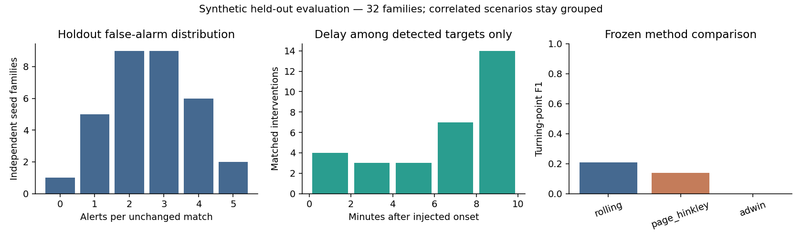

# MatchPulse AI — Why the Game Changed

A synthetic-football research implementation of **Detect -> Prove -> Explain -> Explore**. Step 2.5 adds strict observable tracking, context-conditioned geometry, a frozen detector comparison and independently recomputable positional EvidencePacks while preserving the event-only Step 2 system.

**Current verdict: CONDITIONAL GO for verified defensive-line explanations; broad tactical-intervention detection remains below target.** On 40 fresh held-out families the selected fused detector achieves **47.5% precision, 36.25% recall, F1 0.411**, and **0.35 alerts per unchanged match**. It detects 33/40 strong changes, 5/40 moderate changes, 0/40 press-only changes and 20/40 low-block changes within ten minutes. All 180 selected-detector packs verify numerically. Correct facts do not establish a coach's intent.

The underlying line signal replicates: strong interventions shift the line by +11.91m relative to paired nulls (95% family-bootstrap interval +11.01 to +12.68m). Carrier-closing and local pressing density do not show consistent high-press separation. No Foundry agents, frontend, Azure deployment or real-world calibration exists.

## Review Step 2.5 first

- [Final verdict](research/step25/final-verdict.md): actual quality gates and claim restrictions.
- [Feature separation](research/step25/feature-separation.md): the signal-existence experiment and negative pressure findings.
- [Detector comparison](research/step25/detector-comparison.md) and [held-out results](research/step25/evaluation-results.md): selection, denominators, uncertainty and failures.
- [Execution walkthrough](research/step25/execution-walkthrough.md): real success/false/missed examples, arithmetic and debug CLI.
- [Protocol](research/step25/evaluation-protocol.md), [validation](research/step25/validation-and-leakage.md), [reproduction commands](research/step25/execution-commands.md), [product boundary](research/step25/product-decision.md).
- [Tracking audit](research/step25/tracking-audit.md), [schemas](research/step25/tracking-schema.md), [feature definitions](research/step25/feature-engineering.md), [root causes](research/step25/root-cause-analysis.md), [literature](research/step25/literature-review.md), [competitor source comparison](research/step25/competitive-comparison.md).

Step 2.5 uses 24 development, 16 validation and 40 holdout families (seven scenarios each). Configuration/source hashes were frozen before final generation. This holdout is now consumed: new tuning requires a new untouched set. New bulk datasets/cache/exports stay local under the Step 2.5 brief; existing tracked Step 1/2 artifacts are preserved.

## Preserved Step 2 research

The original event-only result remains **NO-GO** for its target: 13.3% precision, 48.4% recall, F1 0.209, 2.625 alerts/unchanged match. See its [comparison](research/step2-detector-comparison.md), [results](research/step2-evaluation-results.md), [verdict](research/step2-final-verdict.md), [failure analysis](research/step2-failure-analysis.md), [walkthrough](research/step2-execution-walkthrough.md) and [architecture](research/step2-architecture.md). Different scenario denominators mean the old/new figures are not a single unchanged benchmark.

## Actual Step 2 results

56 independent new seed families, disjoint from Step 1: **24 development**, **32 holdout**. Each family has five correlated scenarios: unchanged, strong bundle, moderate bundle, tempo-only and temporary bundle. 120 development matches and 160 held-out matches were generated. Injection clocks varied across 55/60/65/70 cumulative minutes; small roster-strength variation and naturally generated score differences are retained.

Primary holdout accuracy covers 96 null/strong/moderate matches with 64 eligible interventions. The frozen rolling method detected **31/64**, missed **33**, and emitted **202 unmatched alerts**. Its 32 unchanged matches produced **84 alerts**. Median detection delay was **420 seconds**, conditional on a matched target. Tempo/pulse cases are separate ambiguous stress tests, not artificially labeled negatives.

All **417 emitted holdout EvidencePacks** recomputed correctly. Replay was deterministic across all 160 matches; prefix invariance passed all 160 checks. These establish implemented/tested properties, not a real-world accuracy or security guarantee.



## Setup from a clean checkout

Requirements: Git, Node 24/npm, uv and network for dependency/source installation. uv installs/selects Python **3.12.13**; system Python 3.14 is not used. Run from the repository root:

```sh
uv sync --project backend --frozen --extra dev
npm ci --prefix poc --ignore-scripts
git clone https://github.com/tbleckert/football-simulator.git upstream/football-simulator
git -C upstream/football-simulator checkout --detach 39529b19c40868d66aa47db084ebc9ea29c86e70
git -C upstream/football-simulator rev-parse HEAD
```

If the upstream checkout already exists, inspect its commit/status and reuse it; do not clone over it or reset user changes. The generator verifies this exact source commit. The MIT source is used directly; the published npm tarball lacks required licensing/provenance evidence and is not substituted. No upstream npm install is needed for our generator.

## Run the CLI

Canonical research data is versioned in this private repository. Generate the fixed holdout dataset if absent (this generates observations; it does not tune or evaluate the detector):

```sh
cd poc
npx tsx src/step2-dataset.ts --holdout
cd ..
uv run --project backend matchpulse data/step2/inference/dc053576-202b-4d5c-ace7-2b5659f68e70.jsonl --debug --output backend/output/demo.json
```

This verified example processes 6,903 events and emits three observed-change alerts, including two unmatched to the external intervention. The matched NORTH alert at 3,780s has recovery means 35.08m -> 61.37m and high recovery actions 4 -> 16 over adjacent eight-minute windows. These are real computed values, not expected values hardcoded in the CLI. `--debug` prints sparse processing transitions on alerts. The CLI accepts UUID-named canonical files and a label-free config, never experiment metadata. It needs no cloud credentials or LLM.

## Reproduce selection and evaluation

The checked-in `backend/config/selected.json` is a failed research candidate, not a production recommendation. The frozen config/source fingerprints and compact results are in `research/step2-artifacts/`.

To reproduce the original fixed protocol (do not retune on its holdout):

```sh
cd poc
npx tsx src/step2-dataset.ts
cd ..
uv run --project backend python backend/scripts/evaluate.py development
cd poc
npx tsx src/step2-dataset.ts --holdout
cd ..
uv run --project backend python backend/scripts/evaluate.py holdout
uv run --project backend python backend/scripts/verify.py
uv run --project backend python backend/scripts/plot_results.py
uv run --project backend python backend/scripts/write_reports.py
```

The generator resumes existing canonical/record pairs; evaluation checks their hashes. Delete/regenerate only deliberately selected stale research data if changing the generation specification; do not silently reuse stale caches as new experiments. Winner selection/config/source freeze occurs before holdout scoring. Selection initially favored silent ADWIN; the development-only correction and all candidate results are recorded. No final holdout outcomes were used to choose new parameters. Any future tuning needs a **new untouched seed-family test set**.

Complete Step 2 canonical data occupies about **1 GiB** and full local EvidencePack exports about **176 MiB**. Generated data, logs and detailed result files are versioned at the user's request. Installed dependencies and environments remain ignored. Compact results, per-match CSV, source/config fingerprints, charts, dependency notices and a 100-event canonical test fixture remain reviewable. Performance measurements and exact denominators are in the evaluation report. Generated artifacts are stored in this private repository; its visibility has not changed.

## Tests and verification

```sh
uv run --project backend pytest backend/tests -q
cd poc
npm run typecheck
npm test
```

Actual final results: **36 pytest tests passed, zero failed; seven TypeScript tests passed, zero failed; TypeScript typecheck passed**. Python compile checks and the actual CLI demo also passed. No separate Python static type checker is configured. `verification.json` records the exact commands, exit codes and local logs.

Step 1 TypeScript artifact tests additionally require the original experiment outputs. They are included in this private repository; regenerate them if absent or when explicitly reproducing Step 1:

```sh
cd poc
npm run experiment
npm run experiment -- --bundle
```

Tests cover strict/malformed/null/out-of-play ingestion, sequence/ID/order invariants, team direction, no duplicate recovery/entry counting, sparse windows, halftime, stable/toy streams, cooldown, deterministic isolated replay, future-event invariance, hidden-metadata rejection, evidence tampering/recomputation, matching and grouped partitions. Real canonical fixture tests run without the large dataset.

## Data flow and ownership

`canonical JSONL -> Pydantic -> replay -> event contributions -> before/after team signals -> detector -> EvidencePack -> CLI`

The simulator and adapter remain TypeScript. The Python inference package knows only canonical observations, opaque identity and explicit detector parameters. Its rolling method compares recovery location and advanced recovery share with support/effect/persistence/cooldown guards. River Page-Hinkley and ADWIN use the same evidence guards in their comparison pipelines. The evaluation orchestrator alone reads hidden interventions and performs one-to-one matching within a frozen 600s horizon.

Evidence includes exact windows, raw/normalized facts, units, score semantics, complete canonical-prefix references and quality warnings. Illustrative event IDs are explicitly separate from complete calculation evidence. A score is not a calibrated probability. An observed spatial shift does not establish a coach's decision or causation.

## Licensing and Step 1 provenance

The source engine is pinned at `39529b19c40868d66aa47db084ebc9ea29c86e70`, manifest version 2.0.0, MIT copyright Tobias Bleckert. [THIRD_PARTY_NOTICES.md](THIRD_PARTY_NOTICES.md) preserves the notice. River 0.22.0 is BSD-3-Clause; Pydantic is MIT; installed dependency notices and locked versions are retained. No third-party football imagery, footage or match dataset is used; generated clubs/players are fictional. Redistribution must carry applicable bundled numerical-library notices too.

Step 1 reports remain intact: [feasibility verdict](research/feasibility-verdict.md), [simulator audit](research/simulator-audit.md), [tactical experiment](research/tactical-experiment.md), [execution analysis](research/architecture-analysis.md), [canonical contract](research/event-schema.md), [licensing audit](research/licensing-audit.md). Its conditional simulator adoption did not establish detector accuracy.

## Next milestone

Repair or narrow the analytical target using development data, then validate a newly frozen method on untouched families. Preserve the working ingestion, evidence, tests and CLI. Foundry integration is deferred until alert quality clears the agreed targets. After that gate, the planned flow is EvidencePack -> Tactical Analyst -> Broadcast Narrator -> deterministic Grounding Validator. Counterfactuals, tracking animation, real-world prediction, frontend and deployment remain outside this milestone.
