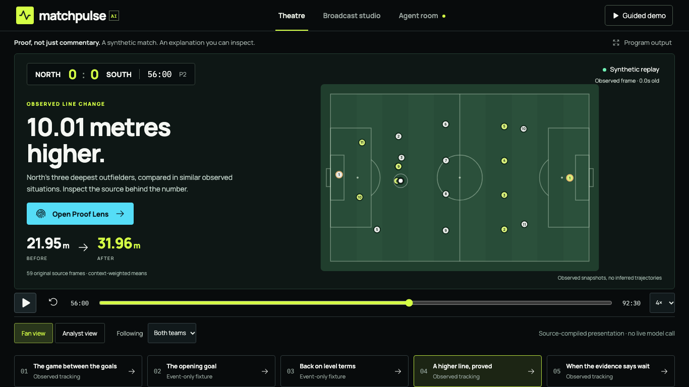

# MatchPulse AI — Proof, not just commentary.

An evidence-first AI broadcast studio for synthetic football. Follow the match, switch between Fan and Analyst, and open **Proof Lens** to recompute an explanation from the original events or player positions. Microsoft Foundry and Agent Framework provide bounded specialist orchestration; deterministic verification decides what can be displayed.

**Detect → Prove → Explain → Explore**



The default **Theatre** opens on a genuine tracked line comparison: **21.95m →31.96m, +10.01m**, supported by 59 original frames. **Broadcast studio** retains the detailed workspace. Proof Lens has Summary, contributor inspection, Method and Audit, plus a verified JSON receipt. The roughly 80-second guided story uses clearly separate goal, tracking and stale-evidence fixtures. `/?view=broadcast` provides clean program output. Fonts and runtime notices are bundled locally.

Start locally using the commands below. Public deployment/video remain pending until final acceptance; audited release is authorized only at ₹0 out of pocket. [Release evidence](research/step3e/final-submission-evidence.md) · [Data card](DATA_CARD.md) · [Agent card](AGENT_CARD.md) · [Evaluation](EVALUATION.md) · [Evidence map](research/step3e/rubric-gap-map.md).

### Five stages, one inspectable result

**Ingest** canonical synthetic events/tracking → **Interpret** independently verified claims → **Explain** bounded specialist plans and source-derived wording → **Render** clock-synchronized overlays → **Personalize** Fan/Analyst and favorite-team framing. Replay is progressive over recorded input; it does not trigger a new live model run on every click.

Read the [actual request walkthrough](research/step3e/execution-walkthrough.md), [Foundry platform audit](research/step3e/microsoft-foundry-compliance.md), [Proof Lens review](research/step3e/proof-lens-review.md), [browser evidence](research/step3e/browser-acceptance.md), [design decisions](research/step3e/design-system.md), [product use case](research/step3e/real-world-product-case.md) and [zero-out-of-pocket hosting decision](research/step3e/zero-cost-hosting-decision.md). No real Premier League feed, tactical intent, broad reliability or real-model quality advantage is claimed.

The research below preserves Step 2/2.5 outcomes, including failed broad detection targets. The UI redesign does not change those findings or establish real-match calibration.

The [Product Excellence architecture and gap register](research/product-excellence/architecture.md) consolidates the system, source capabilities and next milestones. [Buffered replay](research/product-excellence/buffered-replay.md) keeps the pitch mounted, advances a causal source prefix without per-tick full-view requests and rejects future snapshots on backward seeks. Its packaged-native regression passed31/31. This remains recorded replay, not a live-input service.

The accepted [native goal showcase](research/product-excellence/native-goal-showcase.md) adds **Goals, in motion**: two observed goals and 22,401 original quarter-second position frames from one reproducible run. Packaged browser regression passed33/33; backend198 passed with two disabled live tests skipped. The original five fixtures remain intact. Selection is explicitly a goal-bearing demo example, not new statistical evidence; the new goals compile deterministically and are separate from the historical Foundry capture.

## Broadcast studio — Step 3C

The local React/TypeScript studio now connects to a source-verifying Python API: five isolated match scenarios, synchronized observed positions/clock/score, Fan/Analyst and favorite-team controls, restricted questions, recaps and an interactive Proof Lens. Proof Lens recomputes line geometry from original player coordinates and exposes all 59 contributing samples, source hashes, timing and limitations. It also shows when stale evidence must be withheld.

Microsoft Agent Framework/Foundry integration is authenticated and tested. A newly authorized real goal workflow is now **persisted with enriched narration and replay**, then independently reverified before display: 23.83 seconds, five agent requests, five successful evidence-tool calls and 11,662 input / 807 output reported tokens. The earlier partial/fallback capture remains a separate historical recovery example. Other cards/adaptations compile deterministically; replay clicks make **no cloud model calls**. These are single-run observations, not reliability or quality-superiority measurements. See [capture provenance and metering limitation](research/step3d/foundry-capture.md). English only; synthetic data; no inferred coach intent or real-world accuracy claim. Azure hosting and public submission remain pending.

Run from the repository root using the existing isolated SDK environment:

```sh
backend/.venv-foundry/bin/pip install -r backend/requirements-viewer.txt
backend/.venv-foundry/bin/python -m matchpulse.viewer.api
# In a second terminal:
npm ci --prefix web
npm run dev --prefix web
```

Open http://127.0.0.1:5173. A fresh checkout needs the canonical fixture preparation described in [deployment and reproduction](research/step3c/deployment.md); the full research dataset is not a public-host requirement. See [acceptance evidence](research/step3c/acceptance.md), [security review](research/step3c/security-readiness.md) and [submission/demo package](research/step3c/submission.md).

**Current verdict: CONDITIONAL GO for verified defensive-line explanations; broad tactical-intervention detection remains below target.** On 40 fresh held-out families the selected fused detector achieves **47.5% precision, 36.25% recall, F1 0.411**, and **0.35 alerts per unchanged match**. It detects 33/40 strong changes, 5/40 moderate changes, 0/40 press-only changes and 20/40 low-block changes within ten minutes. All 180 selected-detector packs verify numerically. Correct facts do not establish a coach's intent.

The underlying line signal replicates: strong interventions shift the line by +11.91m relative to paired nulls (95% family-bootstrap interval +11.01 to +12.68m). Carrier-closing and local pressing density do not show consistent high-press separation. These research conclusions remain unchanged by the subsequent Foundry integration and frontend. Azure hosting and real-world calibration remain unverified.

## Review Step 2.5 first

- [Final verdict](research/step25/final-verdict.md): actual quality gates and claim restrictions.
- [Feature separation](research/step25/feature-separation.md): the signal-existence experiment and negative pressure findings.
- [Detector comparison](research/step25/detector-comparison.md) and [held-out results](research/step25/evaluation-results.md): selection, denominators, uncertainty and failures.
- [Execution walkthrough](research/step25/execution-walkthrough.md): real success/false/missed examples, arithmetic and debug CLI.
- [Protocol](research/step25/evaluation-protocol.md), [validation](research/step25/validation-and-leakage.md), [reproduction commands](research/step25/execution-commands.md), [product boundary](research/step25/product-decision.md).
- [Tracking audit](research/step25/tracking-audit.md), [schemas](research/step25/tracking-schema.md), [feature definitions](research/step25/feature-engineering.md), [root causes](research/step25/root-cause-analysis.md), [literature](research/step25/literature-review.md), [competitor source comparison](research/step25/competitive-comparison.md).

Step 2.5 uses 24 development, 16 validation and 40 holdout families (seven scenarios each). Configuration/source hashes were frozen before final generation. This holdout is now consumed: new tuning requires a new untouched set. New bulk datasets/cache/exports stay local under the Step 2.5 brief; existing tracked Step 1/2 artifacts are preserved.

## Preserved Step 2 research

The original event-only result remains **NO-GO** for its target: 13.3% precision, 48.4% recall, F1 0.209, 2.625 alerts/unchanged match. See its [comparison](research/step2-detector-comparison.md), [results](research/step2-evaluation-results.md), [verdict](research/step2-final-verdict.md), [failure analysis](research/step2-failure-analysis.md), [walkthrough](research/step2-execution-walkthrough.md) and [architecture](research/step2-architecture.md). Different scenario denominators mean the old/new figures are not a single unchanged benchmark.

## Actual Step 2 results

56 independent new seed families, disjoint from Step 1: **24 development**, **32 holdout**. Each family has five correlated scenarios: unchanged, strong bundle, moderate bundle, tempo-only and temporary bundle. 120 development matches and 160 held-out matches were generated. Injection clocks varied across 55/60/65/70 cumulative minutes; small roster-strength variation and naturally generated score differences are retained.

Primary holdout accuracy covers 96 null/strong/moderate matches with 64 eligible interventions. The frozen rolling method detected **31/64**, missed **33**, and emitted **202 unmatched alerts**. Its 32 unchanged matches produced **84 alerts**. Median detection delay was **420 seconds**, conditional on a matched target. Tempo/pulse cases are separate ambiguous stress tests, not artificially labeled negatives.

All **417 emitted holdout EvidencePacks** recomputed correctly. Replay was deterministic across all 160 matches; prefix invariance passed all 160 checks. These establish implemented/tested properties, not a real-world accuracy or security guarantee.


## Setup from a clean checkout

Requirements: Git, Node 24/npm, uv and network for dependency/source installation. uv installs/selects Python **3.12.13**; system Python 3.14 is not used. Run from the repository root:

```sh
uv sync --project backend --frozen --extra dev
npm ci --prefix poc --ignore-scripts
git clone https://github.com/tbleckert/football-simulator.git upstream/football-simulator
git -C upstream/football-simulator checkout --detach 39529b19c40868d66aa47db084ebc9ea29c86e70
git -C upstream/football-simulator rev-parse HEAD
```

If the upstream checkout already exists, inspect its commit/status and reuse it; do not clone over it or reset user changes. The generator verifies this exact source commit. The MIT source is used directly; the published npm tarball lacks required licensing/provenance evidence and is not substituted. No upstream npm install is needed for our generator.

## Run the CLI

Canonical research data is versioned in this private repository. Generate the fixed holdout dataset if absent (this generates observations; it does not tune or evaluate the detector):

```sh
cd poc
npx tsx src/step2-dataset.ts --holdout
cd ..
uv run --project backend matchpulse data/step2/inference/dc053576-202b-4d5c-ace7-2b5659f68e70.jsonl --debug --output backend/output/demo.json
```

This verified example processes 6,903 events and emits three observed-change alerts, including two unmatched to the external intervention. The matched NORTH alert at 3,780s has recovery means 35.08m -> 61.37m and high recovery actions 4 -> 16 over adjacent eight-minute windows. These are real computed values, not expected values hardcoded in the CLI. `--debug` prints sparse processing transitions on alerts. The CLI accepts UUID-named canonical files and a label-free config, never experiment metadata. It needs no cloud credentials or LLM.

## Reproduce selection and evaluation

The checked-in `backend/config/selected.json` is a failed research candidate, not a production recommendation. The frozen config/source fingerprints and compact results are in `research/step2-artifacts/`.

To reproduce the original fixed protocol (do not retune on its holdout):

```sh
cd poc
npx tsx src/step2-dataset.ts
cd ..
uv run --project backend python backend/scripts/evaluate.py development
cd poc
npx tsx src/step2-dataset.ts --holdout
cd ..
uv run --project backend python backend/scripts/evaluate.py holdout
uv run --project backend python backend/scripts/verify.py
uv run --project backend python backend/scripts/plot_results.py
uv run --project backend python backend/scripts/write_reports.py
```

The generator resumes existing canonical/record pairs; evaluation checks their hashes. Delete/regenerate only deliberately selected stale research data if changing the generation specification; do not silently reuse stale caches as new experiments. Winner selection/config/source freeze occurs before holdout scoring. Selection initially favored silent ADWIN; the development-only correction and all candidate results are recorded. No final holdout outcomes were used to choose new parameters. Any future tuning needs a **new untouched seed-family test set**.

Complete Step 2 canonical data occupies about **1 GiB** and full local EvidencePack exports about **176 MiB**. Generated data, logs and detailed result files are versioned at the user's request. Installed dependencies and environments remain ignored. Compact results, per-match CSV, source/config fingerprints, charts, dependency notices and a 100-event canonical test fixture remain reviewable. Performance measurements and exact denominators are in the evaluation report. Generated artifacts are stored in this private repository; its visibility has not changed.

## Tests and verification

```sh
uv run --project backend pytest backend/tests -q
cd poc
npm run typecheck
npm test
```

Actual final results: **36 pytest tests passed, zero failed; seven TypeScript tests passed, zero failed; TypeScript typecheck passed**. Python compile checks and the actual CLI demo also passed. No separate Python static type checker is configured. `verification.json` records the exact commands, exit codes and local logs.

Step 1 TypeScript artifact tests additionally require the original experiment outputs. They are included in this private repository; regenerate them if absent or when explicitly reproducing Step 1:

```sh
cd poc
npm run experiment
npm run experiment -- --bundle
```

Tests cover strict/malformed/null/out-of-play ingestion, sequence/ID/order invariants, team direction, no duplicate recovery/entry counting, sparse windows, halftime, stable/toy streams, cooldown, deterministic isolated replay, future-event invariance, hidden-metadata rejection, evidence tampering/recomputation, matching and grouped partitions. Real canonical fixture tests run without the large dataset.

## Data flow and ownership

`canonical JSONL -> Pydantic -> replay -> event contributions -> before/after team signals -> detector -> EvidencePack -> CLI`

The simulator and adapter remain TypeScript. The Python inference package knows only canonical observations, opaque identity and explicit detector parameters. Its rolling method compares recovery location and advanced recovery share with support/effect/persistence/cooldown guards. River Page-Hinkley and ADWIN use the same evidence guards in their comparison pipelines. The evaluation orchestrator alone reads hidden interventions and performs one-to-one matching within a frozen 600s horizon.

Evidence includes exact windows, raw/normalized facts, units, score semantics, complete canonical-prefix references and quality warnings. Illustrative event IDs are explicitly separate from complete calculation evidence. A score is not a calibrated probability. An observed spatial shift does not establish a coach's decision or causation.

## Licensing and Step 1 provenance

The source engine is pinned at `39529b19c40868d66aa47db084ebc9ea29c86e70`, manifest version 2.0.0, MIT copyright Tobias Bleckert. [THIRD_PARTY_NOTICES.md](THIRD_PARTY_NOTICES.md) preserves the notice. River 0.22.0 is BSD-3-Clause; Pydantic is MIT; installed dependency notices and locked versions are retained. No third-party football imagery, footage or match dataset is used; generated clubs/players are fictional. Redistribution must carry applicable bundled numerical-library notices too.

Step 1 reports remain intact: [feasibility verdict](research/feasibility-verdict.md), [simulator audit](research/simulator-audit.md), [tactical experiment](research/tactical-experiment.md), [execution analysis](research/architecture-analysis.md), [canonical contract](research/event-schema.md), [licensing audit](research/licensing-audit.md). Its conditional simulator adoption did not establish detector accuracy.

## Next milestone

Repair or narrow the analytical target using development data, then validate a newly frozen method on untouched families. Preserve the working ingestion, evidence, tests and CLI. Foundry integration is deferred until alert quality clears the agreed targets. After that gate, the planned flow is EvidencePack -> Tactical Analyst -> Broadcast Narrator -> deterministic Grounding Validator. Counterfactuals, tracking animation, real-world prediction, frontend and deployment remain outside this milestone.

## Step 2.6 — reliable presentation of positional evidence

The selected Step 2.5 detector is **frozen**, and its published accuracy numbers remain unchanged. A separate **fail-closed presentation gate** now independently verifies the geometry/event evidence and checks whether the latest contributing observation is fresh enough (within 60 simulated seconds), with minimum recent/reference observation spans (30s/60s). These initial display rules have **not** been independently evaluated as a new classifier. Suppressed alerts remain visible in the original research exports.

When you run the tracking CLI with `--output backend/output/step25/demo.json`, it additionally writes `demo.presentation.json` (all quality decisions/reasons) and `demo.broadcast.json` (only eligible, verified observed-line claims). Treat `demo.json` and legacy `demo.facts.json` as **research-only**, not agent-ready claims. The approved statement describes the three deepest outfielders' sampled positions; it does not infer a coach's instruction or successful pressing.

See [presentation quality gate and frozen scope](research/step25/presentation-quality-gate.md). The [completed PR reliability review](research/step25/presentation-pr1-review.md) passes 71 Python tests, 10 TypeScript tests, type checking and both real CLI fixtures, with unchanged research exports. A new published accuracy estimate still requires an untouched cohort; these checks establish reliability, not improved detector accuracy.

## Step 3A — Verified match stories (local)

Implemented a deterministic match-story engine under `backend/src/matchpulse/stories/`: observed goals/score context, shots and linked outcomes, conservative high gains and same-possession attacks, rolling shot counts, red cards, match boundaries and presentation-approved line measurements. Every public fact passes a namespaced claim registry and evidence recomputation before scheduling. No LLM or Azure service is deployed.

[Actual verdict](research/step3a/final-verdict.md): **CONDITIONAL GO**.104 Python tests,10 TypeScript tests and typecheck pass;4 actual full replay examples,664 verified claims,294 emitted timeline items. Human editorial review is pending; external schema meta-validation could not install due network DNS. Frozen7m research and its negative accuracy conclusions remain intact.

[Generate and run the demo](research/step3a/execution-commands.md), [complete real-match timeline](research/step3a/demo-match-walkthrough.md), [learn the execution flow](research/step3a/execution-walkthrough.md), [measurements](research/step3a/evaluation-results.md), [verification](research/step3a/verification-results.md).

```sh
backend/.venv/bin/python -m matchpulse.stories.cli --events <UUID>.jsonl --output backend/output/stories/demo --debug
```

Optional: `--tracking <UUID>.tracking.jsonl.gz --positional-config research/step25/artifacts/selected.json`. Outputs include timeline.json, insights.json, claims.json, evidence-index.json, suppressed.json, summary.json, presentation.json and compact agent-inputs.json. Full new exports stay local; compact review artifacts and compressed canonical fixtures are under research/step3a/artifacts. This remains synthetic, uncalibrated football; a regain is not proof of pressing effectiveness, an observed line is not a coach instruction, and chance_quality is not xG.

Next: [one authenticated Foundry call with a verified envelope and strict response validation](research/step3a/foundry-handoff.md), then audience narration within a reviewed grounding contract. [Frontend handoff](research/step3a/frontend-handoff.md) specifies exact timeline/evidence data; no React implementation is included yet.

## Step 3B — Adaptive broadcast studio (live goal integration verified)

New `backend/src/matchpulse/agents/` implements controlled Director, event/tactical specialists, Challenger, Narrator and Replay Producer roles; scoped evidence tools; version2 narrative/visual compilation; partial failure recovery; audience/team preferences; narrow read-only questions; and traceable broadcast artifacts. The original stories/ code remains factual authority.

**Authenticated Foundry proof and one complete goal workflow now pass.** The separately opted-in integration module reports4 passed, including enriched narration/overlay and model-requested claim/evidence tools through actual Microsoft Agent Framework. Local post-provider-repair regression159 passed/2 intentionally skipped live tests. Preserve the repaired AIProjectClient lifecycle in provider.py. Earlier fake artifacts and saved partial/fallback live captures keep their original labels; the fully enriched live test did not persist its BroadcastArtifact. Cloud telemetry/public hosting and broad reliability are not established. See [Azure setup and mandatory live gates](research/step3b/foundry-setup.md), [actual verdict](research/step3b/final-verdict.md), [architecture](research/step3b/architecture-research.md), [results](research/step3b/evaluation-results.md) and [demo commands](research/step3b/demo-walkthrough.md).

```sh
backend/.venv/bin/python -m matchpulse.agents.cli studio --events data/step2/inference/02840f35-cb05-4812-aa9d-1237e4ab1b9d.jsonl --insight-type goal_context --provider fake --output backend/output/agents/goal.json
backend/.venv/bin/python backend/scripts/step3b_review.py
```

Fan editorial policy reduces the honest0–0 timeline from63 to18 items by hiding repetitive standalone gains; Analyst Mode keeps63. All original verified facts/research outputs remain intact. Free factual prose, extra unregistered context, coaching intent, calibrated xG and unsupported localization are rejected. Extra agents have not demonstrated real-model superiority over the simpler baseline. [Execution walkthrough](research/step3b/execution-walkthrough.md) and [frontend contract](research/step3b/frontend-handoff.md) explain the exact boundaries.

Historical initial Step3B verification:156 Python tests passed/5 integration skips;10 TypeScript tests and typecheck passed. Later SDK validation and provider repair:159 passed/2 live opt-in skips locally; separate live module4 passed in29.87s. No suite or paid call was rerun for the documentation update. [Current live evidence](research/step3b/artifacts/live-foundry-validation.json) and [Step3C implementation file plan](research/step3b/step3c-implementation-plan.md) supersede earlier blocked-status notes without rewriting historical results.
