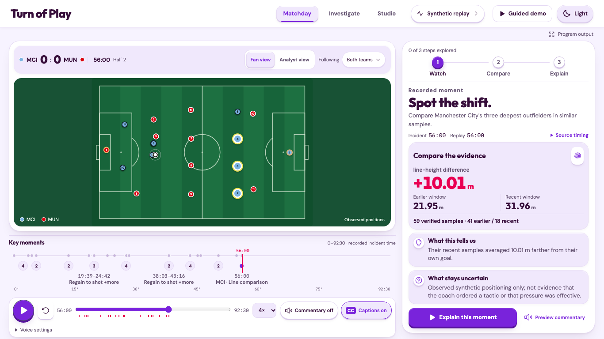

# Turn of Play

**See what changed. Understand what supports it. Know what remains uncertain.**

Turn of Play turns recorded synthetic football observations into a match experience you can investigate. Watch a source-aligned replay, choose a moment, compare its evidence and open **Proof Lens** to recompute the explanation from the original events or player positions.



## Try the complete journey

1. **Matchday:** play the native goal fixture. Score, observed positions and the timeline follow one replay clock. Choose Fan or Analyst and follow either presentation club.
2. **Compare:** choose **A higher line, proved**. Its sampled line estimate changes from **21.95m to 31.96m**, supported by **59 original frames: 41 earlier/18 recent**. Open Proof Lens for the calculation, contributors, method, observations and a verified receipt.
3. **Investigate:** select an original source player, highlight its recorded position and inspect x/y, observation time and frame identity. Selection pauses the replay. Source IDs are not real-player names or shirt numbers.
4. **Check uncertainty:** choose **When the evidence says wait**. A recorded review withholds the current positional comparison because the relevant evidence was 132 seconds old at that review.
5. **Studio:** inspect genuine recorded Microsoft Foundry/Agent Framework routing, evidence tools, Challenger narrowing and separate branch recovery. Viewer interactions make no new model calls.

Light/dark themes, keyboard/touch controls, optional browser-local English commentary and captions are included. Voice availability depends on the platform. Manchester City/Manchester United are the default **display labels on synthetic observations**, with 20 selectable PL club palettes; these are not actual club matches or performances.

The six scenarios are isolated source fixtures: native goals, open play, opening goal, equalizer, line comparison and withheld evidence. They are not consecutive chapters of one real match.

## Run locally

Use **Python 3.12 and Node 24**. Keep viewer dependencies separate from the frozen analytical lock. The current local environment is `backend/.venv-foundry`; a fresh viewer environment can be prepared with:

```sh
python3.12 -m venv backend/.venv-viewer
backend/.venv-viewer/bin/python -m pip install -e ./backend -r backend/requirements-viewer-lock.txt
npm ci --prefix web
```

Obtain the existing checksum-reviewed [viewer-fixtures-v2 release bundle](https://github.com/ansh0eman/matchpulse/releases/tag/viewer-fixtures-v2) and restore its ten declared source files plus manifest to `backend/output/viewer-bundle-v2`. See the [release/runtime instructions](infra/README.md) and the canonical allowlist in `backend/src/matchpulse/viewer/catalog.py`. Do not regenerate consumed research experiments as a startup shortcut.

```sh
# Terminal 1: API. Substitute backend/.venv-foundry/bin/python in the existing SDK environment.
MATCHPULSE_VIEWER_BUNDLE="$PWD/backend/output/viewer-bundle-v2" \
  backend/.venv-viewer/bin/python -m matchpulse.viewer.api

# Terminal 2: frontend, http://127.0.0.1:5173
npm run dev --prefix web
```

Start with `/?scenario=native-goals` or `/?scenario=line-shift&clock=3360`. `/?view=studio` opens Investigate; `/?view=broadcast` is clean program output. Replay requires no Azure login, model key or participant account.

The [Dockerfile](Dockerfile.viewer) builds the frontend and serves the source-verifying Python API as a non-root user. Publishing and deployment must use the accepted image/source identity and release gates; a local URL is not judge access.

## Architecture and factual authority

`Pinned simulator → canonical observations → deterministic claims → independent verification → optional bounded agent plans → source-reverified publication → replay / Proof Lens`

The Python registry, compilers and original source observations own facts. Models can select registered claims and controlled narrative/visual plans. They cannot invent authoritative numbers, identities or tactical intent. Recorded Foundry enrichment is revalidated before display; unsupported branches fall back independently. Analytical jobs are serialized on a background worker, keeping health/catalog responsive without loading multiple large tracking matches concurrently.

[Architecture](research/product-excellence/architecture.md) · [Data card](DATA_CARD.md) · [Agent card](AGENT_CARD.md) · [Agent comparison and limits](research/product-excellence/priority9-foundry-value-review.md)

## Validation and current release status

The [current status index](research/product-excellence/CURRENT_STATUS.md) distinguishes local source, packaged image, public deployment, participant feedback and submission. The older hosted release has not been updated by the current local work. Do not infer current hosted acceptance from local results.

- [Review repairs](research/design/turn-of-play/product-sprint-1-review-repair-acceptance.md): 142 frontend passes/one intentional skip on that revision.
- [P7 measurements](research/product-excellence/priority7-performance-acceptance.md): 215 backend passes/two live opt-in skips, 30 focused browser passes; identical measured source responses.
- [P8 source inspection](research/product-excellence/priority8-investigate-acceptance.md): 14 browser passes and typecheck.
- Human comprehension and comparative model-quality ratings remain uncollected. Prior voice acceptance is separate.

Run checks against a running local API/frontend, preserving unique output paths:

```sh
npm run typecheck --prefix web
npm run build --prefix web
MATCHPULSE_TEST_URL=http://127.0.0.1:5173 npm test --prefix web
MATCHPULSE_LIVE_TEST=0 MATCHPULSE_LIVE_WORKFLOW_TEST=0 \
  backend/.venv-foundry/bin/python -m pytest backend/tests -q
npm run typecheck --prefix poc
npm test --prefix poc
```

Backend tests need the development dependencies; simulator artifact tests need their documented existing inputs. Real-provider tests are explicitly opt-in and must not run as ordinary acceptance.

## Research boundaries and provenance

The frozen Step 2.5 broad intervention detector missed its targets: **47.5% precision  / 36.25% recall** on its consumed holdout. Conditional support applies to independently verified sampled line-height facts, not general tactical-change or pressing detection. UI improvements do not retune those results or establish coach intent, pressing success, causal effects or real-world calibration.

[Step1 feasibility](research/feasibility-verdict.md) · [Step2 results](research/step2-evaluation-results.md) · [Frozen Step 2.5 verdict](research/step25/final-verdict.md) · [Evaluation](EVALUATION.md) · [Third-party notices](THIRD_PARTY_NOTICES.md)

The simulator source remains pinned at `39529b19c40868d66aa47db084ebc9ea29c86e70` with its MIT notice. Component/font licenses are bundled locally. Source availability does not grant a new license to original project code. The [previous README](research/product-excellence/readme-before-turn-of-play-release-2026-10-26.md) is retained as historical documentation.
