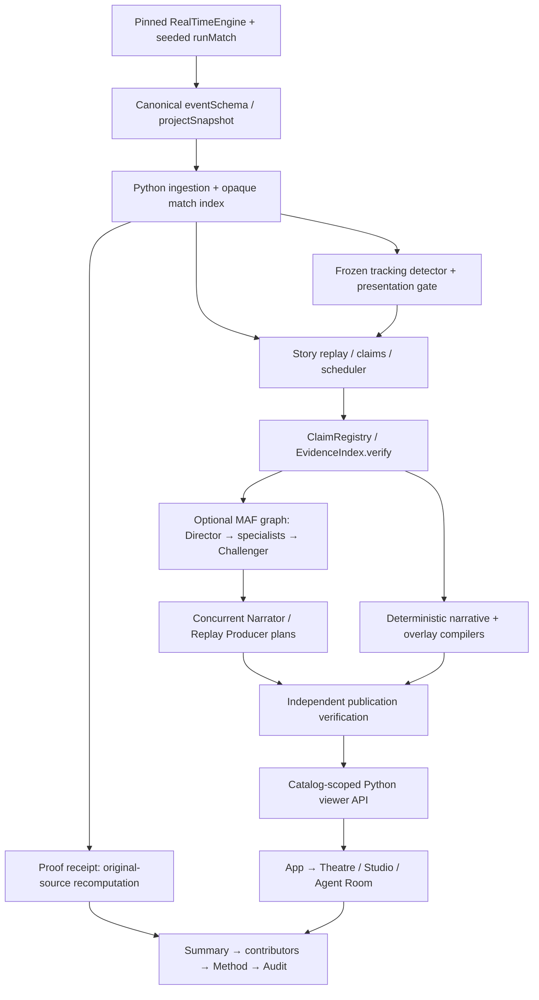

# Product architecture and authoritative gaps

This index consolidates prior evidence; it does not replace frozen findings. Last committed baseline: 2b7097200549c264c2ceb8aeca9b68a6b1d1f973. Current uncommitted milestone repairs playback continuity. Public release remains gated on the final accepted artifact, not an arbitrary October 25 feature cutoff.

| Subsystem | Actual responsibilities / dependencies | Evidence and limits |
|---|---|---|
| Synthetic source | poc/src/simulation.ts `runMatch`; schema.ts; tracking/schema.ts `projectSnapshot`. Pinned source, injected seeded randomness, explicit native snapshot projection. | Ten simulator tests pass. A showcase seed is not a scientific test split; goals/positions must come from the same run. |
| Ingestion and source semantics | backend/src/matchpulse/ingestion.py, schemas.py; tracking/ingestion.py. Strict observations, sequence/UUID constraints and touch-based possession. | Original source parity/prefix tests; schema support does not prove every fixture contains every event type. |
| Tracking research | tracking/features.py, windows.py, detector.py, presentation.py, evidence.py. Positions → conditioned line proxy → frozen alerts → separate fail-closed presentation gate. | Historical precision47.5%, recall36.25%, F1≈.411 remain unchanged. No coach-intent or pressing-success inference; consumed holdout cannot be reused for tuning. |
| Match Story Engine | stories/replay.py, claims.py, registry.py, evidence.py, scheduler.py. Claims verify independently before eligible public incidents. | Recorded 664/664 verification and 294 timeline items are prior four-match results, not new accuracy or usefulness measurements. |
| Agent workflow | agents/workflow.py `Studio`; framework.py `run_graph`; provider.py; tools.py; schemas.py. Typed state, conditional roles and scoped tools. | Genuine saved Foundry/MAF goal; local role definitions, zero registered Agent Service agents in inspected project. See linked compliance audit. |
| Publication | agents/narrative_compiler.py, overlay_compiler.py, publication.py. Derive facts from approved IDs, verify plans, independently recover branches. | Existing adversarial suite and source-reverified success/fallback. Model consensus is not source verification. |
| Viewer | viewer/catalog.py, schemas.py, service.py, proof.py, api.py. Five isolated recorded fixtures, prefix scores, bounded questions and recomputed receipts. | 181 backend tests/2 deliberately disabled live tests in Step3E. No deployed live producer or model call per viewer interaction. |
| Frontend | App.tsx, playback/causal.ts, broadcast/, ProofLens, proof/ProofSummary, agents/DecisionEvidence. Context-safe state and observed SVG positions. | Continuity targeted4/4; full development21/21 and packaged native21/21 passed. Four-second jumps at4× are source snapshots, not measured continuous trajectories. |
| Evaluation | backend/scripts/step3d_evaluate.py and EVALUATION.md. Comparable offline engineering modes/fault cases. | FakeProvider A/B/C requests0/52/94; no real-model superiority or fabricated human ratings. |
| Release | Dockerfile.viewer, exact fixture manifest, infra/viewer.bicep, manual publishing workflow and check_viewer_release.py. | Protected trial verified throughNov22, ₹0 conditions retained. Newest artifact not yet accepted/public; save/load identity and actual HTTPS still need verification. |

Start with [gaps.json](gaps.json), [capabilities.json](capabilities.json), [competitor matrix](competitor-matrix.md) and [playback milestone](playback-continuity.md). Detailed prior sources: [Foundry compliance](../step3e/microsoft-foundry-compliance.md), [source/code competitor audit](../step3e/competitive-audit.md), [request walkthrough](../step3e/execution-walkthrough.md), [frozen tactical verdict](../step25/final-verdict.md), [evaluation](../../EVALUATION.md), [release audit](../step3e/release-readiness.md).
