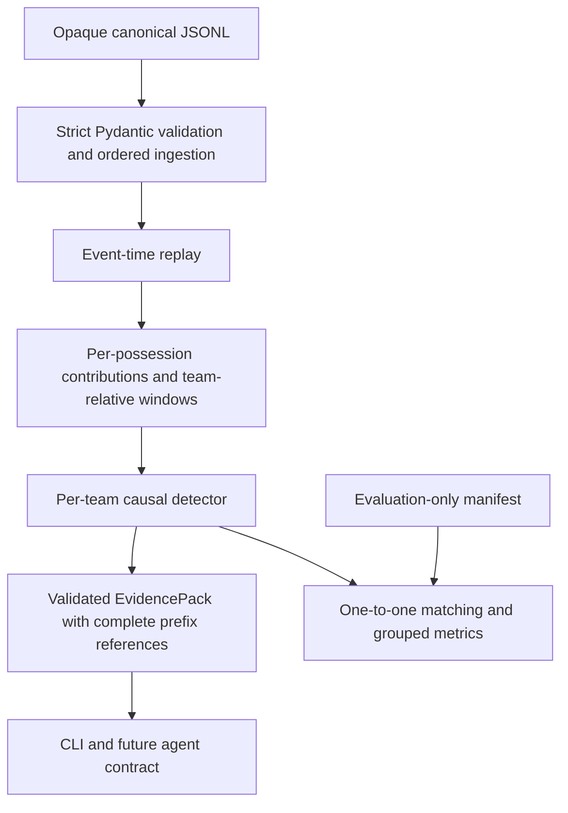

# Step 2 architecture

## Source ownership

| File | Responsibility and entry points |
|---|---|
| `backend/src/matchpulse/schemas.py` | Strict/frozen Pydantic models, finite numeric fields, canonical event kind allowlist, nullable actors, explicit coordinate consistency and UUID identity. Rejects extra metadata/control-event kinds. Out-of-play ball positions are allowed. |
| `ingestion.py` | `validate_stream` parses JSONL lazily, rejects duplicate IDs, sequence/source gaps, backward clock/period/score and actor-team contradictions. `load_match` opens one UUID-named canonical file and yields events. No manifest/roster/source-audit reads. |
| `signals.py` | `SignalState.update` converts events into recovery/episode/progression contributions; `observe` and `window_stats` produce fixed-exposure before/after/minute stats. `changes` computes interpretable spatial effect scores. |
| `detectors/rolling.py` | `DetectorConfig`, `RollingDetector`, `Alert`: support/effect thresholds, persistence, period reset and cooldown. Separate instances per team/match. |
| `detectors/streaming.py` | `StreamingDetector` wraps installed River PageHinkley/ADWIN. Nonoverlapping minute scalar input, independent period resets, bounded 180-second drift eligibility, same rolling evidence guards. |
| `replay.py` | `observations` serves deterministic feature extraction; `replay` is actual inference, consumes only observed events and identity/config, emits evidence. No import of evaluation. |
| `evidence.py` | Strict EvidencePack contract, deterministic ID, complete causal-prefix calculation references, clearly separate illustrative events, metric definitions/limitations. `verify_evidence` reconstructs observations and score from canonical evidence. |
| `evaluation.py` | Evaluation-only fixed one-to-one matching, primary and ambiguous scenario summaries, grouped bootstrap. Never imported by CLI/inference modules. |
| `cli.py` | `main`: parse opaque input, read a label-free selected detector config, run validation/replay, print computed facts, optionally export JSON and sparse debug transitions. |
| `backend/scripts/evaluate.py` | Offline development grid, freeze selected config/source hashes, held-out scoring, real evidence checks, deterministic/prefix checks. Evaluation manifests stay here, outside inference. |
| `poc/src/step2-dataset.ts` | Generates fixed disjoint families/scenarios into opaque filenames; labels and real intervention clocks go only to separate evaluation records. Guards exact upstream commit. |
| `poc/src/simulation.ts` | Preserved Step 1 default API plus optional scheduled tactical changes, attribute offsets, and disabled snapshot-size instrumentation for dataset throughput. Upstream engine implementation unchanged. |

## Causality and clock semantics

A minute observation at time t uses all events with timestamps <=t, including all tied timestamps. Replay finalizes a boundary only after the tied group has been consumed (or at a prefix EOF). It never pushes the next event into state before emitting earlier observations. Appending future data must preserve earlier alerts and their evidence byte-for-byte. No wall-clock sleeps, full-match normalization or match-end filtering affects inference.

Before window `(t-2W,t-W]`; after `(t-W,t]`. Events exactly at split belong only to before. Half-time clears positional/window state; an alert requires both full windows within the current period. Added time comes from source cumulative clock, not an assumed 45/90-minute endpoint. There is a new support warm-up after halftime, not a hardcoded minute-60 detection.

Recoveries use source normalized coordinates, checked against raw pitch location/team/period at validation. Positive entry increments are computed once when an event arrives; counts are never summed directly from repeated possession counters. Challenge episodes are grouped across window boundaries with a five-second gap rule. Full-prefix references retain the prior events needed for those stateful calculations.

## Isolation and storage

Inference takes `Iterable[CanonicalEvent]`, `MatchIdentity`, and `DetectorConfig`. Typed models reject hidden fields and nonopaque IDs. The CLI takes only UUID-named JSONL, without passing its directory/name to detectors. Opaque IDs may be deterministic hashes of generation records; their hex strings are not interpreted by analytics. Production modules do not open evaluation manifests or import evaluation helpers. Tests patch filesystem opening during replay and attempt truth/policy injection.

The generator and evaluation orchestrator necessarily know labels, but pass only canonical observations to the shared inference functions. These are source/module/API boundaries, not an operating-system sandbox: Python code with arbitrary filesystem access could bypass them. Tests establish the implemented path's behavior, not security against hostile Python plugins.

Only the contribution window history is pruned. Ingestion's ID set, possession/episode dictionaries and replay's evidence prefix grow with match size; memory is O(events), intentionally acceptable for offline ~7k-event fixtures. This is incremental inference, not a claim of constant-memory unbounded streaming. Evidence construction and full-prefix verification add work per alert. Optimize reference transfer only after correctness and detection quality are acceptable.

## Agent handoff contract (planned, not implemented)

Future agents receive validated EvidencePack schema_version=1: opaque match/detection IDs, emission clock/team, observed-change type/direction, exact windows, before/after Facts, method/config/uncalibrated score, definitions, full calculation references and quality warnings. The Analyst may interpret observed spatial changes with references; the Narrator may personalize wording. A deterministic grounding validator must resolve every numeric fact key and citation to this pack. No agent is allowed to calculate authoritative statistics or infer hidden coaching intent from labels. Full reference lists may eventually be stored behind a resolver while sending only verified facts and reference handles; that optimization is not implemented here.
