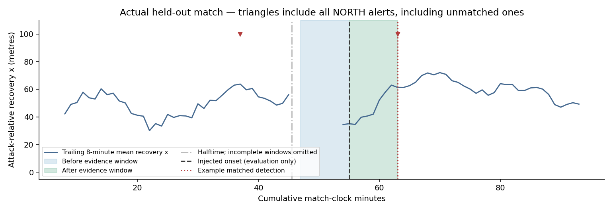

# Independent evaluation results

**NO-GO for Foundry integration.** The causal analytics/evidence path works, but the external-intervention detector does not meet the predeclared accuracy or false-alarm targets.

## Dataset and frozen protocol

56 new seed families total: 24 development (i=0..23), 32 holdout (i=24..55), seed=1009+7919*i. The original 12 Step 1 seeds are excluded. Each family contains null, strong bundle, moderate bundle, tempo-only and 180s bundle pulse; all share the same side of the split. Five runs per family yields 120 development and 160 holdout matches. All generated runs were included; none were removed for poor outcomes. No source audit or simulator-control data entered inference.

Cumulative injection times cycle 3300/3600/3900/4200 seconds. Home/away roster strengths vary oppositely by -1/0/+1 attribute point. Score is generated organically, not manually injected; onset score is recorded only for evaluation stratification. Bundle matches use the Step 1 bundle. Moderate: style high_press, press75, line70, tempo58, compactness48, balanced mentality. Tempo-only sets tempo70. Pulse restores the original base tactics after 180s. Endogenous score/fatigue/injury/card adaptation remains enabled in every scenario.

Primary accuracy includes null, bundle and moderate only (96 holdout matches). Tempo and pulse are ambiguous stress cases: they can create observed statistical changes, so they are not assigned manufactured 'no change' truth labels or mixed into primary precision. Their alert activity is disclosed separately. This definition is implemented in evaluation.py and was set before final scoring.

Credit the first NORTH upward alert in [onset,onset+600s], one-to-one. Further eligible alerts count as duplicates/unmatched; wrong-team, earlier or later alerts are unmatched. No-intervention alerts count toward the conservative external-target false-alarm proxy. This evaluates alignment with injected interventions, not the truth of every naturally observed statistical shift.

## Primary held-out metrics

- Independent holdout families: **32**.
- Eligible interventions: **64**; matched **31**, missed **33**.
- Total primary alerts: **233**; unmatched **202**.
- Precision: **13.3%**; recall **48.4%**; F1 **0.209**.
- No-external-intervention matches: **32**; alerts **84**, **2.625/match**.
- Exposure-normalized no-intervention alert rate: **2.533 per 90 simulated minutes**, including added-time exposure in the denominator.
- Median delay among matched targets: **420s (7.0min)**; missed targets do not enter this delay statistic.
- Duplicate matches within the 600s horizon: **0**, partly by construction because cooldown=900s exceeds the horizon. This does not prove no repeat alerts over a whole match.

| Metric | Estimate | Seed-cluster bootstrap 95% interval |
|---|---:|---|
| precision | 0.133 | [0.094, 0.176] |
| recall | 0.484 | [0.328, 0.641] |
| f1 | 0.209 | [0.148, 0.275] |
| false_alerts_per_null_match | 2.625 | [2.219, 3.094] |
| median_delay_seconds | 420.000 | [300.000, 480.000] |

Intervals use 1,000 deterministic percentile bootstrap resamples of entire seed families, retaining correlated scenarios. They quantify local sampling variability, not professional-football validity, simulator uncertainty or model-selection uncertainty. Small family count and reused synthetic mechanics limit interpretation.

| Scenario | Matches | Eligible external onsets | Matched detections | Alerts |
|---|---:|---:|---:|---:|
| null | 32 | not a primary positive | not scored as recall | 84 |
| bundle | 32 | 32 | 17 | 75 |
| moderate | 32 | 32 | 14 | 74 |
| tempo | 32 | not a primary positive | not scored as recall | 89 |
| pulse | 32 | not a primary positive | not scored as recall | 95 |

## Reliability and processing performance

All 417 emitted holdout EvidencePacks (including stress-case alerts) were recomputed from their complete canonical-prefix references: **417/417 valid**. All 160 matches replayed deterministically, including IDs, facts and references. Prefix invariance at 3660s passed for **160 matches**. Additional pytest fixtures append adversarial future coordinates and reject hidden truth/policy parameters. These are actual tested properties, not proof against arbitrary malicious Python code.

The 160 holdout matches contain 1,096,343 canonical events. One measured validation pass took 15.921s total (99.51ms/match average). Actual first inference replay plus EvidencePack construction took 10.866s total (67.92ms/match average), excluding independent verification, repeated replay, prefix checks, plotting, file exports and generation. These averages are not p95 event latency or production service benchmarks. Python 3.12.13, Apple Silicon, local files, fixed dependency lock.

Frozen configuration/source fingerprint: `cb8848b5bfca606b88abe27b8b42e35650cc6f0acafbe5719e49741e16ea9812`. Holdout manifest SHA-256: `8bae38bbc127599fccc4f7e64add8bc3207653f4334dff33269b1f241012e31c`. Detailed ignored local JSON retains every match/alert; compact summaries and per-match CSV retain reviewable results.

## Visual evidence

The true intervention clock appears only in evaluation plotting code. All NORTH alerts in the example are shown, not just its matched alert. Sparse bins and halftime reset remain visible. Chart annotations are not inference inputs.

## Reproduction

See the root README for exact setup/generation/selection/holdout commands. verification.json records actual argv, working directories, logs and exit codes. No holdout-driven parameter changes were made. Future tuning must reserve a new untouched seed-family set, rather than reuse this holdout as confirmatory evidence.
