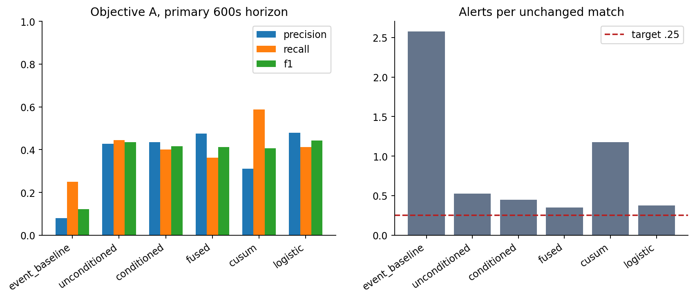

# Frozen candidate comparison

Validation selected **fused geometry + event confirmation**, a deterministic statistical/rule hybrid. It is not a trained classifier. Configuration: reference cap 1200s, recent 180s, clock cadence 30s, >=12/6 frames per common context, line threshold 7m, persistence 2, cooldown 900s, and hysteresis rearming after three quiet checks below 3.5m. Event confirmation requires >=4 recoveries in each adjacent 180s event window plus direction-aligned recovery-location change>=3m OR high-recovery share change>=.05.

## Bounded selection

The full development/validation grid contains 16 candidates: unchanged event baseline; unconditioned and conditioned geometry at 3/5/7m; fused 5/7m; leaky CUSUM thresholds 12/24 with 2.5m instantaneous floor; two development-fitted L2 logistic models (penalties 1/10) at scores .5/.75; and a conditioned 5m 60s cadence ablation. Unconditioned here still requires opponent build-up; it removes within-build-up score/ball-zone/roster mixture matching. No post-holdout search was run.

Ranking was declared before validation: active detections first; null<=.25 first; then 600s F1, precision and delay. Only fused 7m meets the null target on validation (.125 alerts/match), with precision 69.8%, recall 46.9%, F1 0.561 and median 150s. Development values are 57.5%,43.8%, F1 0.497 and .208 null alerts/match. The selection hash is `6b8f4682ec3e8c4b966c8821fd006a89b14746dca49667cbbafbf296d7c8ec24`; freeze-receipt.json records that final holdout did not exist at freeze. Each method's validation finalist is evaluated below without reselection.

## Actual final holdout

40 independent families, 280 matches; 200 primary null/strong/moderate/press-only/low-block matches and 160 eligible external interventions. Correct team and direction, one credit/onset, full-match alert denominator.

| Validation finalist | P600 | R600 | F1 | Null alerts /matches | Median delay s | R1200 |
| --- | --- | --- | --- | --- | --- | --- |
| event_baseline | 7.98% | 25.00% | 0.121 | 103/40 = 2.575 | 480.0 | 38.12% |
| unconditioned | 42.77% | 44.38% | 0.436 | 21/40 = 0.525 | 150.0 | 45.62% |
| conditioned | 43.54% | 40.00% | 0.417 | 18/40 = 0.450 | 150.0 | 41.25% |
| fused | 47.54% | 36.25% | 0.411 | 14/40 = 0.350 | 195.0 | 36.88% |
| cusum | 31.02% | 58.75% | 0.406 | 47/40 = 1.175 | 180.0 | 61.88% |
| logistic | 47.83% | 41.25% | 0.443 | 15/40 = 0.375 | 150.0 | 42.50% |

The selected model stays selected even if another finalist happens to have a better holdout statistic. Alternative-finalist results are descriptive, not a new model-selection round. Simple geometry does not automatically control false alarms; event confirmation improves specificity while suppressing weaker positives. Sequential accumulation does not recover the missing press-only information.

## Supervised ablation and calibration

The tiny logistic fit uses three observable changes: absolute line delta, direction-aligned carrier closing and density10. Scaling and weights use only development. Training has 205 supported fixed examples from 24 families (84 positives), at one pre and one onset+300s point per primary scenario. Related scenarios stay grouped. Unsupported training windows are excluded from fitting, while every match remains in detector evaluation.

The frozen logistic finalist's diagnostic fixed-window holdout has 344/400 supported examples, Brier 0.164 and five-bin ECE 0.080. This task and its class prevalence differ from full-match alerting. It was not recalibrated on holdout; bins in ml-calibration-diagnostic.json show discrepancies. Sigmoid scores remain uncalibrated and must not be narrated as broadcast confidence probabilities. Neither logistic variant justifies added model complexity for the selected pipeline.

Runtime fields in comparison summaries are amortized: common immutable comparisons are calculated once per match and reused, while each detector has fresh independent state. They are not standalone method benchmarks. Raw real-path runtime/memory is reported in validation-and-leakage.md. No PH/ADWIN rerun on an arbitrary new positional scale or offline PELT is claimed; Step 2 already tested their event versions, and CUSUM supplies the bounded positional sequential comparison.
