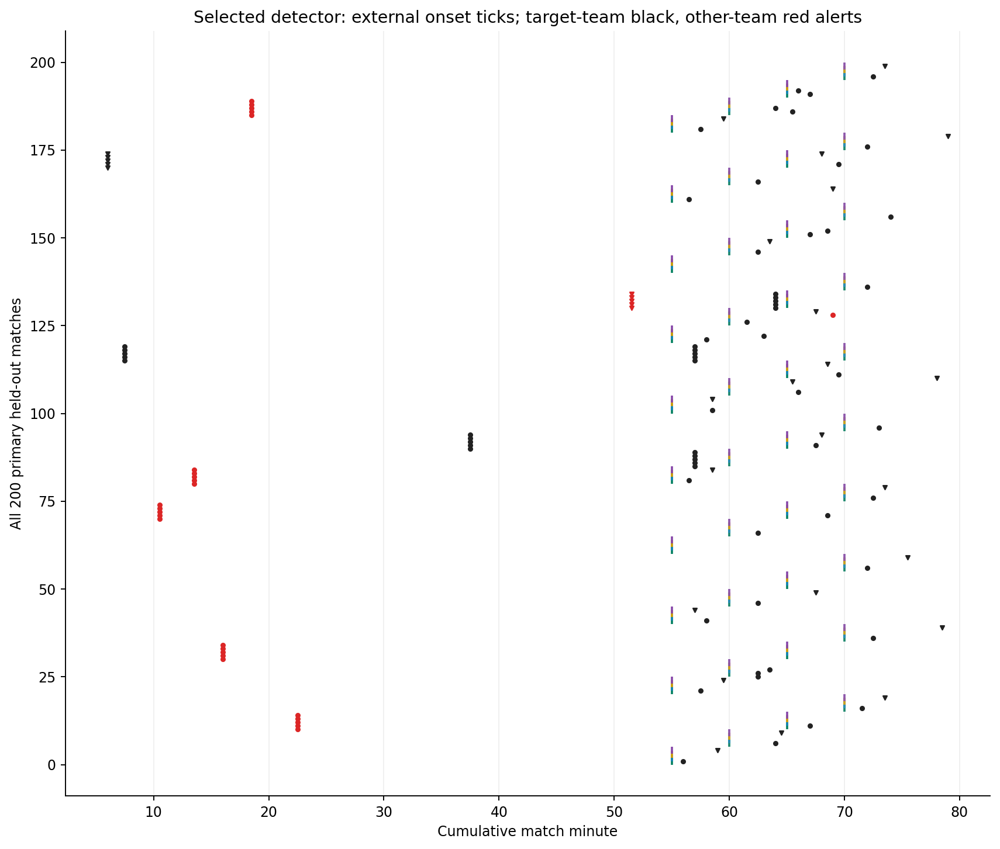
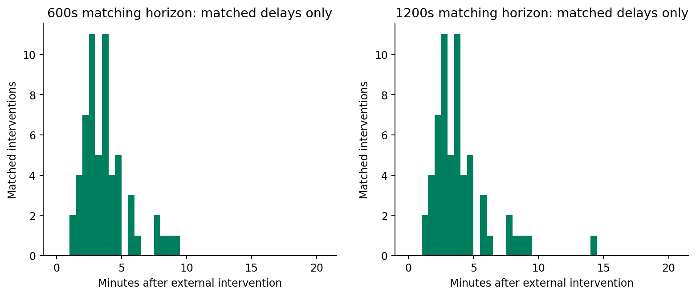
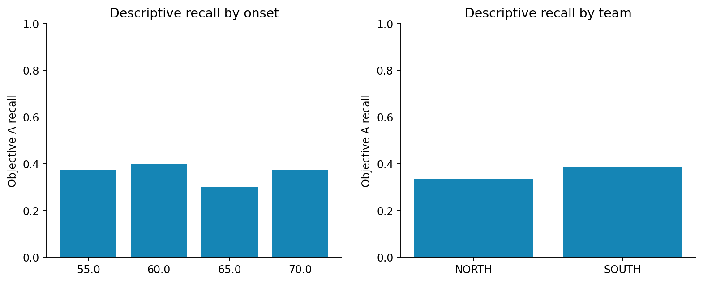

# Actual held-out results

Selected fused 7m detector, frozen before generating the final 40 families. Seed-family intervals use 1,000 bootstrap draws; correlated scenarios remain together. Confirmatory scope is the fixed synthetic engine and declared scenario distribution.

| Metric | 600s | 95% family interval | 1200s | 95% family interval |
| --- | --- | --- | --- | --- |
| Precision | 47.54% | [33.80%, 65.00%] | 48.36% | [34.57%, 66.29%] |
| Recall | 36.25% | [30.00%, 41.88%] | 36.88% | [30.63%, 42.50%] |
| F1 | 0.411 | [0.324, 0.496] | 0.418 | [0.33, 0.505] |
| Alerts/unchanged match | 0.350 | [0.175, 0.525] | 0.350 | [0.175, 0.525] |
| Median matched delay (s) | 195.000 | [150, 210] | 210.000 | [150, 210] |

600s: **58/160 detected, 102 missed, 64 unmatched alerts** across 200 primary matches. Duplicates 0; wrong-team alerts 25; early alerts 48. Categories can overlap. Null matches produce 14/40 alerts; normalized to actual cumulative clock exposure the rate is 0.338 per 90 minutes. This includes added time and is not a wall-clock broadcast rate. The 95th percentile matched delay is reported in final-verdict.md; delay summaries exclude misses and must be read alongside recall.

| Scenario | Matches | Eligible external targets | Hits600 | All alerts |
| --- | --- | --- | --- | --- |
| null | 40 | 0 | 0 | 14 |
| strong | 40 | 40 | 33 | 45 |
| moderate | 40 | 40 | 5 | 17 |
| press_only | 40 | 40 | 0 | 13 |
| low_block | 40 | 40 | 20 | 33 |
| tempo | 40 | 0 | 0 | 13 |
| pulse | 40 | 0 | 0 | 45 |

Tempo and pulse are ambiguous stress cases: they may produce observed changes, so their alerts are reported without falsely calling every one a negative-control error. Press-only remains a primary target even when the spatial effect is tiny. Low block retains the retreat direction; the original event baseline only detects upward recovery shifts and therefore cannot match retreat targets.

All 180 selected-detector packs pass raw geometry, separate coordinate arithmetic and canonical event-fact recomputation. Exact raw/cache agreement, deterministic replay and one real raw-prefix check per match pass 280/280. These establish numerical and tested causal properties, not Objective B classification accuracy or real-football calibration.

Team and onset are confounded by the declared alternation (NORTH 55/65 minutes, SOUTH 60/70). Strata cannot identify an independent team or timing effect. Score emerges endogenously; strengths vary only+/-1 on two fixed fictional squads. New teams, unseen tactic families, other engines and real professional games remain untested. Forty independent families do not become 280 independent experiments or millions of independent tracking frames.
