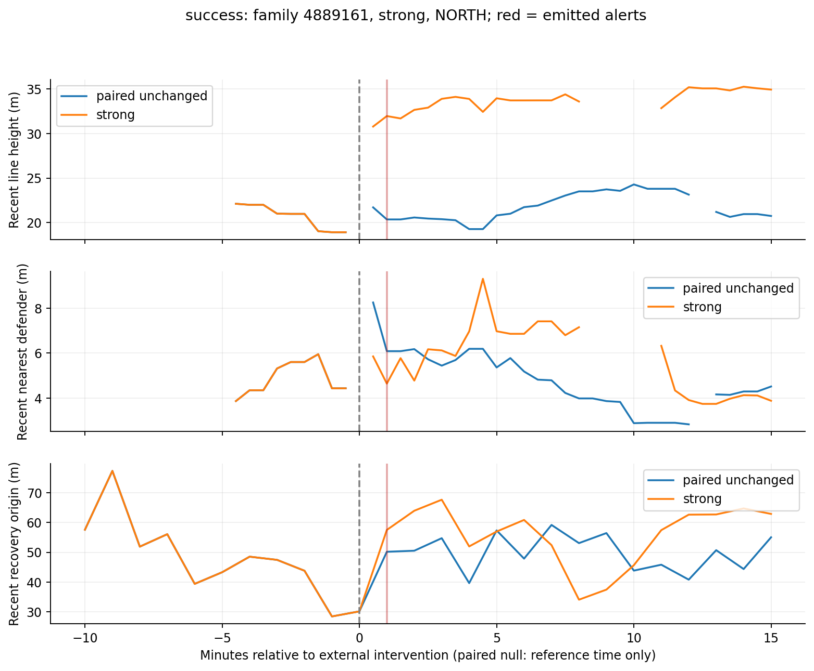
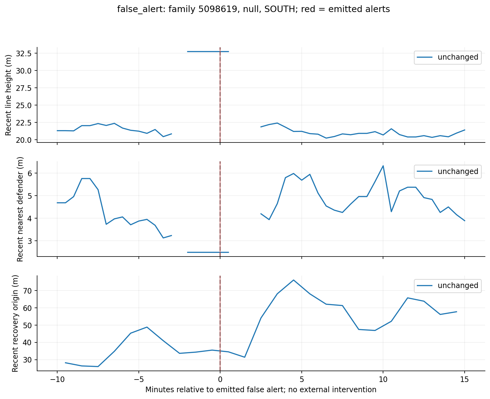
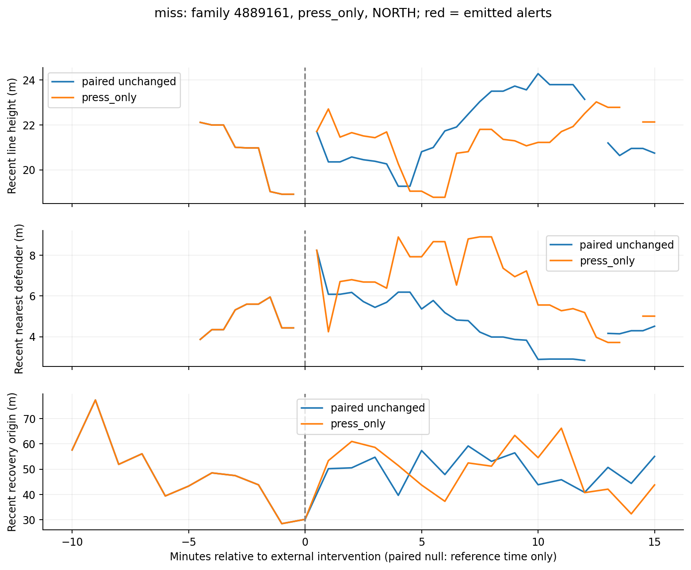
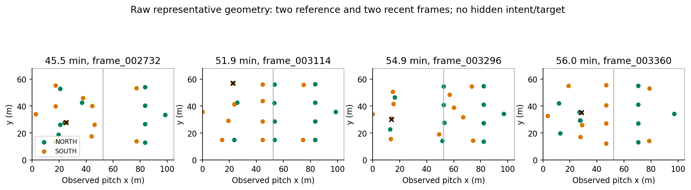

# Trace real code and real observations

This pipeline detects observed spatial changes with deterministic statistics and event rules. The selected path trains no model. Logistic regression remains a separate research ablation whose fitted constants and task are documented in detector-comparison.md.

```text
RealTimeEngine.tick / commitSnapshot / snapshot
    -> runMatch.drain optional onSnapshot callback
    -> projectSnapshot (strict allowlist)
    -> validate_frames / TrackingFrame
    -> extract_features (one defending team, comparable build-up)
    -> TrackingWindows.compare (context-weighted before/after)
    -> detect / PositionalDetector.update (independent team state)
    -> make_pack
    -> verify_geometry + verify_events + independent arithmetic
    -> compact_agent_facts
```

## 1. Engine to observation

`upstream/football-simulator/RealTimeEngine.ts::tick` advances quarter-second simulation ticks. Positions move toward internal targets; after action resolution `commitSnapshot` calls `snapshot`. Targets/intents are legitimate engine inputs but forbidden analytics observations. `poc/src/simulation.ts::runMatch` calls its drain after start/tick; the optional callback observes the snapshot without RNG/state changes. `poc/src/tracking/generate.ts` selects uniformly sampled integer seconds and calls `projectSnapshot` in schema.ts. That function outputs only clock/period/phase/score, ball ownership/coordinates and observed active players. Administrative interventions are recorded separately by the research driver.

`tracking/ingestion.py::load_frames` validates a UUID-named compressed feed through `validate_frames`, enforcing strict schemas, increasing time/sequence and unique IDs. No metadata argument exists. The match ID is used for output identity, not a predictive feature.

## 2. Observation to geometry

`extract_features(frame,team)` returns None for own possession, restarts, invalid owner, non-build-up or insufficient roster; otherwise it returns a FeatureSample. It rotates coordinates for defending-team direction, removes the GK, averages the three deepest outfield x positions and calculates proximity, densities and shape metrics. It tags an observable context from ball zone, score sign and active counts. State is only observed frame data.

`comparisons_from_frames` maintains one TrackingWindows per team, resets on observed period changes and yields fixed30s clock decisions. It finalizes a decision only after all frames at that time are incorporated, never including a later frame. `TrackingWindows.update` appends eligible samples; `compare` drops expired history and computes common-context weighted means with>=12 reference/>=6 recent frames/context. Before and after use the recent context weights, not different context mixtures. It returns complete selected frame IDs.

## 3. Successful external-target example

First qualifying strong success by manifest order: seed4889161, UUID `f2a3e267-d3e5-4c90-ae07-b5a39607ab2d`, targetNORTH, external onset3300s (evaluation only). Alert at3360s, delay60s. Reference window[2710.0, 3180.0], recent[3180.0, 3360.0], both `(start,end]`.

Line3: **21.951 -> 31.964m**, delta10.013m. Score = abs(10.013)/7 = **1.430**, a threshold ratio, not probability. Support: 41 reference frames, 18 recent frames, 1 common contexts. Carrier distance4.910->4.645m; those facts must not be replaced with a generic “more aggressive press” sentence.

`detect` causally updates `SignalState` with canonical events through the current decision time. Fused event confirmation has recovery-location delta13.713m and high-share delta0.308. `PositionalDetector.update` requires a consistent passing direction on two checks; the emitted score describes the final check. After an alert it disarms, tracks cooldown and needs three quiet checks to rearm. The full prefix replay, rather than the pack alone, verifies that history-dependent trigger.

## 4. A false alert with true numerical facts

First unchanged-match alert by the same ordering: seed5098619, UUID `31c70a92-4ce1-4ec2-a570-e8112bfcc5fc`, at1350s, teamSOUTH. Line22.165->32.748m, delta10.583m; score1.512. The windows genuinely differ and their numbers verify. This false case has only eight recent eligible frames, ending at 1218s although the decision is 1350s; overlapping persistence checks do not guarantee new independent build-up opportunities. The statement describes sampled windows, not an instantaneous current position. There is no external intervention to identify. Context bins do not control every aspect of possession, ball movement, stochastic play or endogenous simulator response; the specific causal source is not established by the detector. It is a false positive for ObjectiveA and cannot simply be relabeled a verified coaching decision.

First press-only miss: seed4889161, UUID `cf3c60b8-2d98-48e0-ac3d-8c457e64eed2`, onset3300s, targetNORTH. There is no matching alert within600s. The fixed feature analysis shows why a large line-shift rule can miss this policy; absence of a line alert does not prove no tactical instruction occurred.






## 5. Evidence and debug command

`make_pack` combines exact windows/means/deltas, configuration, support, complete tracking/event references and explicit non-causal wording. `verify_geometry` rebuilds weighted facts from raw positions; `verify_events` rebuilds confirmation counters; research verify.py separately calculates five core geometries. `compact_agent_facts` strips complete histories/reference arrays for future narrative work. Fixtures retain complete geometry calculation frames for these success/false packs, not a manufactured perfect demonstration. Regenerate the full UUID feed for online replay; excerpts are intentionally not a complete timeline.

```sh
backend/.venv/bin/python -m matchpulse.tracking.cli data/step25/inference/f2a3e267-d3e5-4c90-ae07-b5a39607ab2d.tracking.jsonl.gz --events data/step25/inference/f2a3e267-d3e5-4c90-ae07-b5a39607ab2d.jsonl --config research/step25/artifacts/selected.json --debug --output backend/output/step25/demo.json
```

Repeat with `31c70a92-4ce1-4ec2-a570-e8112bfcc5fc` for the false case. No event/position after a decision contributes to its facts; the module never imports evaluation. The research driver later matches alerts against hidden onsets. This separation is the key ownership boundary: the detector observes, the evidence engine proves arithmetic, evaluation judges the external target, and a future agent may explain only the verified observations.
