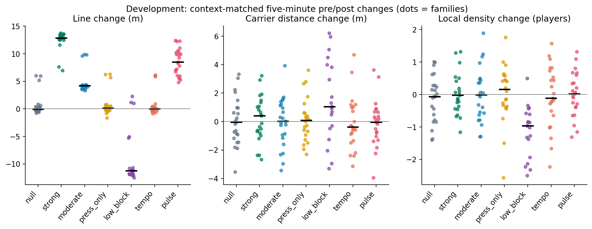
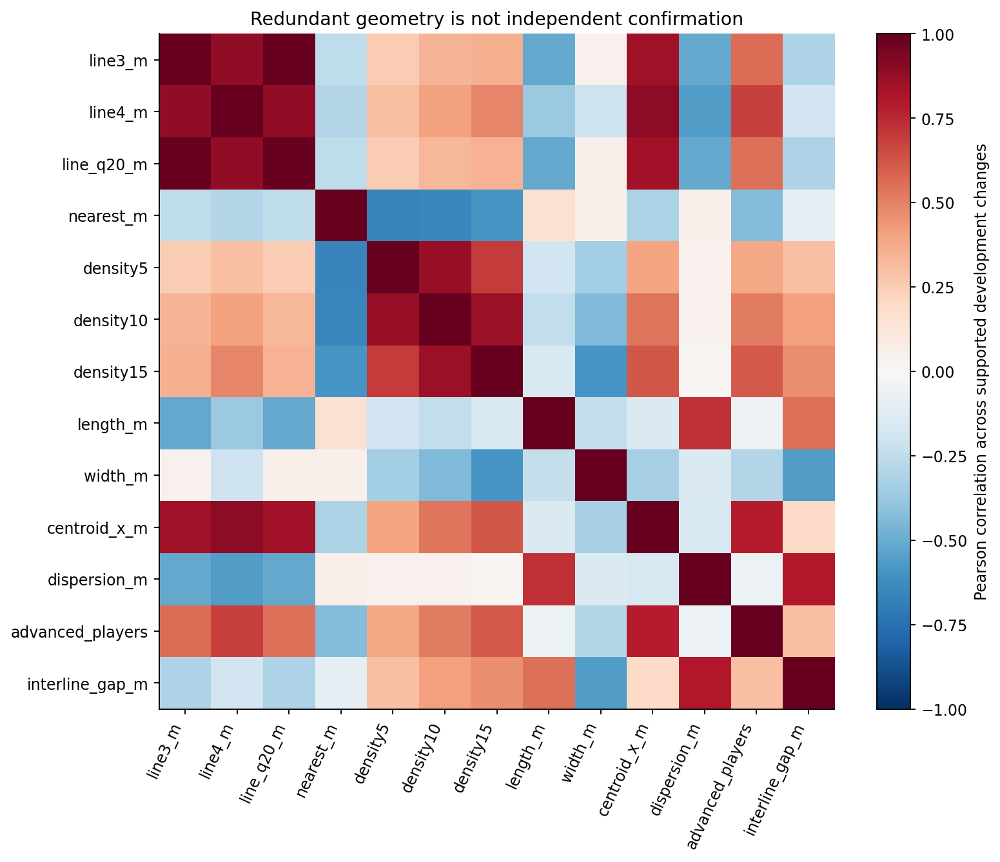

# Does observable signal exist?

**Yes for defensive-line geometry; no convincing improvement in carrier-closing or local pressing density for the high-press interventions examined.** This distinction was established on development before model fitting, then replicated with the same fixed definitions after the final freeze.

## Paired line-height changes

Each number is (post-minus-pre in intervention) minus (post-minus-pre in paired null), context reweighted. Units are metres. Intervals are 95% seed-family percentile bootstrap intervals (1,000 resamples). Five-minute windows use at least four observations per common context; support exclusions are explicit.

| Scenario | Dev pairs /24 | Dev paired change [95%] | Dev distribution AUC | Holdout pairs /40 | Holdout paired change [95%] |
| --- | --- | --- | --- | --- | --- |
| strong | 23 | +11.80 [+10.78,+12.68] | 1.000 | 37 | +11.91 [+11.01,+12.68] |
| moderate | 23 | +4.06 [+3.94,+4.17] | 0.887 | 37 | +3.96 [+3.73,+4.17] |
| press_only | 22 | +0.10 [-0.13,+0.32] | 0.560 | 37 | +0.14 [-0.10,+0.37] |
| low_block | 19 | -9.63 [-10.86,-8.20] | 0.867 | 32 | -9.79 [-10.65,-8.84] |
| tempo | 23 | +0.01 [-0.14,+0.18] | 0.493 | 36 | -0.30 [-0.53,-0.10] |
| pulse | 23 | +7.85 [+6.96,+8.80] | 0.979 | 37 | +8.28 [+7.12,+9.36] |

AUC compares treatment and null change distributions with a prespecified expected direction. It is descriptive development separability, not cross-validated classifier accuracy or intervention recall. Bootstrap uncertainty is conditional on this simulator, feature definition and supported families. Paired seed prefixes are controlled; subsequent RNG consumption can diverge, so these are not isolated causal effects of one tactic parameter.

## Pressure hypotheses that failed

Strong development carrier-distance paired change is +0.156m (95% -0.376 to +0.673), AUC .459; density within 10m is +0.127 players (-0.108 to +0.364), AUC .522. Holdout repeats the lack of a reliable carrier-closing effect: nearest distance +0.404m (-0.028 to +0.823), density +0.125 (-0.136 to +0.382). There is no evidence here to say that the strong policy consistently closes the carrier more aggressively. Moderate and press-only measurements also overlap ordinary fluctuation. Low block produces a lower line and less local density, with fewer supported paired cases.

The four-family pilot was optimistic about proximity; the complete development cohort corrected it. It was never counted as a separate validation set. No pressure composite or neural network was promoted to rescue an unsupported premise.

## Noise, support and redundancy

Development has 156/168 supported window comparisons; holdout 263/280. Primary detector evaluation keeps every match, including unsupported cases. Development strong line change is 5.82 null-change standard deviations; moderate 2.00. These ratios are descriptive effect/noise measures, not independent-frame test statistics. The JSON includes means, medians, direction fractions, null SD and uncertainty for all 13 features.

Line3 and q20 changes correlate almost perfectly, line4 .884 and centroid .844 across supported development changes. Adding them as independent votes would exaggerate evidence. Nearest distance correlates -.254 with line3; its weak response is not a reliable confirming signal. Density radii5/10/15 were fixed before the screen and all remain reported.

The secondary ten-minute recent view preserves line separation (strong +11.86m, moderate +4.10m, press-only +0.30m), while carrier distance still shows little consistent effect. Event recovery-location AUC is .809 strong and .720 moderate, weaker than positional line AUC1.000/.887; all 168 event windows meet the diagnostic four-recovery support threshold. Event outcomes are available but noisier.

The scientifically plausible problem is detecting a sufficiently large observed line shift under comparable possession conditions. The broader claim of identifying every hidden press instruction is not supported.
