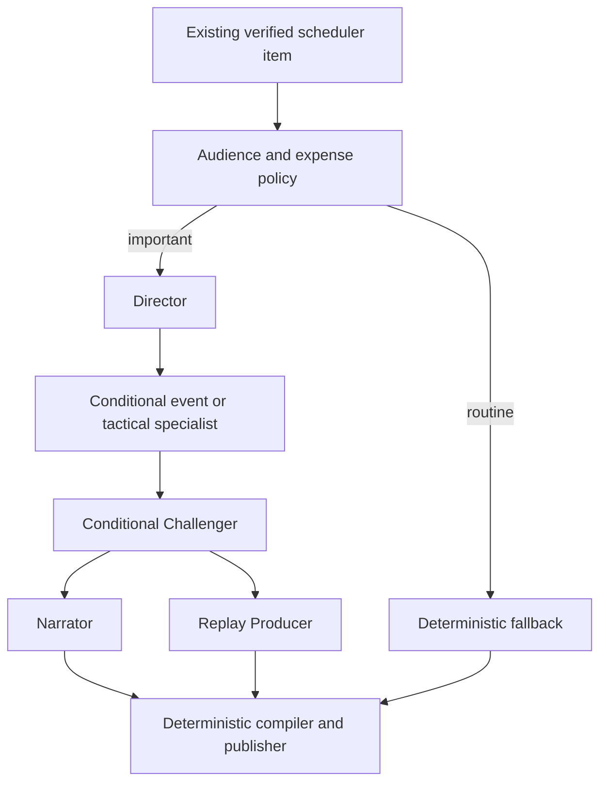

# Actual orchestration boundaries

workflow.py::Studio owns one incident/request context. direct validates route; specialists invokes selected roles with gather; challenge runs only when required; presentation invokes narrator/replay concurrently; publish rechecks source facts and deterministic renderings. Partial failures preserve the other branch. Routine items make no provider calls. Audience suppression happens before Studio in timeline/CLI, independently of fact verification.

framework.py constructs actual SDK Executor/@handler/WorkflowBuilder stages with typed WorkflowState and terminal BroadcastArtifact. Conditional calls and concurrent fan-out/fan-in occur inside those stage executors through shared Python functions; the SDK graph is not claimed to have six independent parallel graph vertices. Default offline execution calls the same stage functions through a distinctly labeled async harness. The real SDK graph has now executed successfully with FakeProvider in the isolated environment. The existing test proves typed graph execution and enriched artifact generation, not authenticated Foundry inference by itself. The later separate live module now also passes the full Foundry goal workflow and model-requested scoped tool assertions; see artifacts/live-foundry-validation.json. No fake module replaces agent_framework.

Current real source insights are single-claim incidents; examples demonstrate alternate event/tactical routes, not both specialists on a fabricated mixed match. Multi-incident synthesis is deferred until its source/context contract is defined. No persistent checkpoint is needed for a bounded incident run; replay is reproducible and correlation/success cache is run-local only. New Studio per incident prevents session/state leakage. Do not reuse a Studio object concurrently across unrelated matches.
